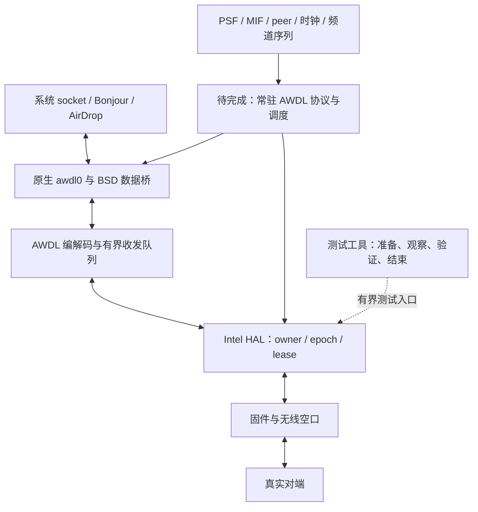

# Test124：先接通真实单包往返，再完成持续 AWDL 服务

更新：2026-11-09。目标是系统原生 AirDrop 双向传文件；本轮先验证驱动的真实发送和回包，避免把接口常驻、固件回执或本地计数当成终点。

## 当前结论

- Test124 的运行契约修复、STA/AWDL 接收去重隔离已完成构建、部署及加载核验。本次 channel 6 / mode 4 单包获得匹配回包，但发送完成与安全收尾未通过，不能把整轮诊断标为成功。
- 独立复核发现前置接收检查误拒合法 IPv6 组播。已复用完整地址验收规则，仅对单播维护重试记录，恢复 Bonjour 所需组播语义；错 IPv6 目标也在前置检查时退回 STA 路径。
- 当前系统为 macOS 26.7.3 / 25G416，已确认加载 Test124。普通 Wi-Fi 接口存在，但本次没有 AP 关联和绑定 Wi-Fi 的联网验收；默认有线路由不能证明无线联网。
- 修复了控制对端必拒真实请求的问题：native mode4 保持内层 IPv6 `ff02::1`，无线目的地址却是选定 peer 单播 MAC；旧 OpenWrt echo 只认组播 MAC。现在按真实生产输出匹配精确 peer 单播地址，交叉测试保留错误地址、nonce 和校验和拒绝。
- 原生 `awdl0` 已有生命周期和 BSD 数据桥。AWDL 同步回调仍有占位返回，peer 表是观察器，shared-window 是离线区间计算器；持续调度尚未成为可运行服务。
- OpenWrt 的 monitor 接收程序排除本机 outgoing 副本后匹配了本轮请求并提交一次回复；原来的 awdl0 绑定 socket 收到一个匹配标记。延迟刷新后的同代驱动收据记录 Captured / Decoded / Delivered 各 1、`ifnet_input` 返回 0。即时快照计数尚未刷新，不能据此否认后续收据，也不能拿延迟快照替换原始失败记录。
- helper 仍以 exit 2 / wait_cleanup / ETIMEDOUT 结束，发送 completion、firmware attempt 和 cleanup ACK 未证明；原始 radio ACK、peer receipt、over-air 标志保持 false。路由器第一次恢复失败，随后 watchdog 恢复并通过幂等只读核验。iPhone 互通、持续收发和 AirDrop 文件收件仍未验收。
- [Test125 候选](../test125/README.md) 修复 END 早于发送完成时过早判失败，以及路由器恢复缺少有界重试的问题；已加载，但本轮在驻留前被旧代MCC发布记录拒绝，尚未验证到发送完成修补。
- [Test126 候选](../test126/README.md) 修正MCC发布接线，单独绑定真实初始化频道表与CHUB来源，并让START、发送前检查和RX交付保持同一许可身份；实机结果待加载后验收。

## 四层职责

| 层 | 已有能力 | 本轮边界与后续责任 |
|---|---|---|
| 原生接口 | `awdl_native_lifecycle_25G332` 创建、注册和保有 Apple 原生接口；BSD 桥管理 ifnet、socket 输入输出和释放 | 保持接口身份、生命周期与引用安全；不由采集脚本模拟协议控制状态 |
| AWDL 协议与调度 | PSF/MIF 编解码、peer 观察表、离线选主与共享窗口模型 | 后续接成唯一常驻状态机：身份、时钟映射、选主、广告、频道序列和 STA 共存；宣告的可用窗口必须与硬件实际驻留一致 |
| Intel HAL | P2P 上下文、频道租约、固件命令/发送完成、RX 描述符与 owner 验收 | 一份 owner/epoch/lease 负责上下文有效性；切换、复位和收尾撤销旧工作，不把 MAC/PHY 推测当接收归属 |
| 数据适配 | 原生 IPv6 与 AWDL 数据帧转换、队列、permit、`ifnet_input` | 前置筛选与投递端用相同地址规则；STA 与 AWDL 重试域分开；成功复制或已确认重复才消费原帧 |

测试工具只负责驱动既有测试入口并保存证据。它不能长期替代上图的常驻服务，也不能通过增加采集次数补出尚未实现的协议状态机。

## 本轮唯一主线：channel 6 / mode 4 精确单包往返

1. 新候选身份、当前启动、原生接口和配置相符；OpenWrt 已有频道 6 接收程序现场输出 READY。构建记录、源码清单、helper 构建记录和部署记录分别核对，不互相冒充。
2. 一个绑定 `awdl0` 的 IPv6 socket 发送本轮唯一 nonce。仍使用既有 LINK/TID0、同代 START 和 100 ms 接收租约；不借用 mode 2 的 RX149 结果证明 mode 4。
3. 对端记录实际收到的请求，核对帧、地址、端口、校验和和 nonce，再返回一次。发送 API 成功或监听到本地发送副本不算对端收件。
4. Intel 记录真实 Data RX，依次通过 descriptor、owner/lease、完整地址规则、permit、BSD 输入；原来的 socket 收到完全匹配的 nonce，才算这条受控双向数据通路通过。
5. 验证关闭和释放。收尾成功只证明资源处置；没有匹配回包仍然是功能未完成。

缺哪一段就定位那一段：对端没收到请求，先查 TX；对端收到但 Mac 无回包，再查 RX。每包的运行 token、身份和时间来自同一已解码的实际帧契约。诊断框架不再复制每一轮的完整执行器。

## 后续顺序

| 阶段 | 出口条件 |
|---|---|
| 受控单包 | 同 socket 的真实请求/回包匹配，资源安全释放 |
| 持续传输 | 常驻协议服务驱动真实驻留，跨窗口收发、重试及取消正确，普通 Wi-Fi 不被实验状态侵入 |
| 原生发现 | IPv6 邻居发现与 mDNS 组播/单播可用，系统获得有效服务端点 |
| 文件传输 | iPhone → Mac 与 Mac → iPhone 都有实际收件、内容完整性和失败恢复证据 |

先完成上游出口，再扩大测试范围。离线测试、接口常驻、硬件发送完成、对端收件和应用收件分别报告；未测不写成失败，也不写成通过。

## 25G416 准入与限制

`verifyTahoeRuntime` 校验精确 OS build / kernel 字符串配对和属性类型，普通 Wi-Fi 保留既有 25G241 / 25G332，再加入 25G416。专用 `verifyTahoeAwdlRuntime` 仅接受 25G332 / 25G416 的完整配对；AWDL 不继承早期缺失 build 属性的宽限，也不自动继承普通 Wi-Fi 的全部版本许可。

这只是版本准入，不是完整 ABI 验收。原生布局、注册记录、回调和清理依赖仍需按候选构建核对；子类尺寸和启动 witness 不能证明全部 Apple ABI 不变。已加载 `25G416-Test124`，UUID 为 `93506514-0468-37CE-805D-6F0EAAEB2091`，来自提交 `bc9ce14` 的构建。独立静态审查比较 9 类实例尺寸、4,102 个虚表槽及 39 个注册/生命周期方法，在选定范围内未发现阻断；该范围不能覆盖全部私有 ABI。当前实机证据覆盖加载、接口挂接及一次定向回包，不覆盖完整生命周期或长期运行兼容。

本轮跳过联网冒烟与睡眠。代码、离线测试和构建可继续；EFI 写入、加载实验驱动、重启及主动无线诊断单独按当前候选与授权执行，不改 WAN/LAN 或安全设置。

## 紧邻的协议兼容项

[MtkWireless PR #5](https://github.com/Dino-VN/MtkWireless/pull/5) 提供的 iOS 嵌入频道序列样本包含非零尾部 `20 e4`。将该公开样本交给本项目真实 `decodeEmbeddedSequence`，目前会被当作非零 padding 拒绝；归零对照通过。这是后续手机 peer 入表的兼容点，尚未用本手机同期抓包确认。它不参与当前人工 peer 的 mode4 单包路径，因此不改本次已冻结内核。后续按实际格式边界独立修复，不照搬 PR 对任意尾字节的宽松接受，也不关闭 peer 或窗口门禁。
